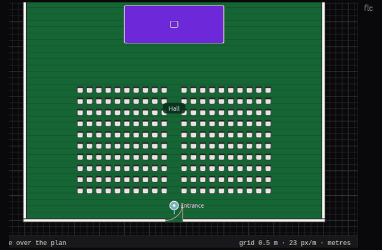

# OpenVenue

[](https://github.com/Rachit7168/OpenVenue/actions/workflows/ci.yml)

OpenVenue is a local-first designer for event spaces. You lay out halls, stages, and zones, then later let visitors walk the same file.

The editor, the visitor view, and a future live layer all read one `venue.json`.

## Status

You can create a project and draw its floor plan: walls, rooms, zones, doors, tables, entrances, and exits. Each wall shows its length, and each door shows its width. Select an item to edit its name, size, and rotation in the inspector. Drag the corner handles to resize a table and the amber handle to rotate it. Shift-click or drag a box to select several items. Middle-drag pans and scroll zooms. The 3D button shows the same hall with walls, a floor, a ceiling, and boxes for the furniture. Orbit and Isometric switch the camera, and Fit and Reset frame the hall. Click a table in 3D to select it, then Move, Rotate, or Scale it; the plan updates and the edit can be undone. Both shows the plan and the 3D hall together, and moving a table on the plan moves that same table in 3D without rebuilding the hall. Floors use concrete, wood, carpet, or glass. Simple turns shadows off for a weak machine, and High keeps a softer light and shadows. Repeated chairs share one mesh, so a crowd of them stays light to draw. Walk uses WASD and the mouse. Click the hall to look around, and Escape returns to orbit. Walls stop the visitor, and doors stay open. The asset row searches the catalogue and a drag onto the plan or the 3D hall places the model. Thirty generated models cover seating, tables, stages, booths, AV, doors and stairs, and safety signs. Each one is Apache-2.0, with its size and attribution recorded. Imported GLB files are checked before they load, and script URLs are refused. The selection stays put when you switch views. Projects stay in this browser and save again about two seconds after an edit. Closing the tab keeps the latest copy, and a newer snapshot is restored if the last write was interrupted. The visitor app (`apps/viewer`) stays separate from the editor.

## Demo

**Conference hall** on the project list opens a 24 by 18 metre room with a door, a stage, a podium, and 200 chairs. The file is `examples/conference-hall.venue.json`.

1. Open the plan. The chairs face the stage, with an aisle down the middle and the entrance on the south wall.
2. Switch to 3D. The same chairs, stage, and podium are in the hall.
3. Choose Walk, click the hall, and use WASD. Escape returns to orbit.



The roadmap is the [issue list](https://github.com/Rachit7168/OpenVenue/issues).

## Quick start

Node.js 22 and pnpm 10.20.0:

```bash
corepack enable
corepack prepare pnpm@10.20.0 --activate
pnpm install
pnpm dev
```

Open http://localhost:5173. The landing page leads to the project list. **New project** asks for a name, hall size, ceiling height, and either an empty hall or a rectangular room. The list stays after a reload. Open a project to rename it, save JSON, or load a file. Checks lists planning warnings, such as a missing exit or furniture outside the room, and says they are not a safety certification. Capacity sums the room and the furniture, and the people figure is a planning estimate, not an approved occupancy number. Export writes the same hall as JSON, an SVG or PNG plan, a one-page PDF, or a GLB. **Open JSON** checks the file against the schema and keeps the current venue if it is invalid. Use **Light** / **Dark** in the top bar to switch theme. The default is dark.

```bash
pnpm build
pnpm test
pnpm lint
```

## Venue file

The schema is `packages/scene-schema/src/schema/venue.schema.json` (draft 2020-12, version 1.0.0).

- Lengths are metres. The world is right-handed, +Y up, angles in radians. Plan points are `{x, z}`.
- Every entity id is a UUID.
- Zones carry an `interaction` (`info-panel`, `link`, `menu`, `session-list`, or `none`). The menu itself is a `contentRef` outside the geometry file.
- `spawnPoints` mark where a visitor starts. Optional `navigation` holds walkable areas and waypoints.
- Unknown properties are kept when you save. See [packages/scene-schema/MIGRATION.md](packages/scene-schema/MIGRATION.md).

Examples:

- [examples/empty-venue.json](examples/empty-venue.json)
- [examples/venue-with-zone.json](examples/venue-with-zone.json)

## Optional API

The editor does not call the API. Django is there for later project sync. It uses a custom user model (UUID primary key), PostgreSQL when `POSTGRES_HOST` is set, Redis settings for later, and OpenAPI docs.

```bash
docker compose up --build
```

- Health: http://localhost:8000/api/v1/health/
- Docs: http://localhost:8000/api/v1/docs/

The Compose password and secret are for local development only. See [SECURITY.md](SECURITY.md).

To run the editor from Docker instead of Vite:

```bash
docker compose --profile web up --build web
```

http://localhost:8080

Dockerfiles: [apps/api/Dockerfile](apps/api/Dockerfile) and [apps/web/Dockerfile](apps/web/Dockerfile).

## Layout

| Path                    | Role                                        |
| ----------------------- | ------------------------------------------- |
| `apps/web`              | Vue 3 editor shell                          |
| `apps/viewer`           | Future read-only visitor app                |
| `apps/api`              | Optional Django API                         |
| `packages/scene-schema` | `venue.json` schema, types, validator       |
| `packages/geometry`     | Plan math, snapping, walls, and rooms       |
| `packages/editor-core`  | Undoable commands                           |
| `packages/scene-engine` | Document store for the 2D plan and later 3D |
| `packages/renderer-2d`  | Plan viewport: pan, zoom, and grid          |
| `packages/renderer-3d`  | Three.js hall built from the venue document |

## License

[Apache-2.0](LICENSE). See [CONTRIBUTING.md](CONTRIBUTING.md) and [CODE_OF_CONDUCT.md](CODE_OF_CONDUCT.md).
